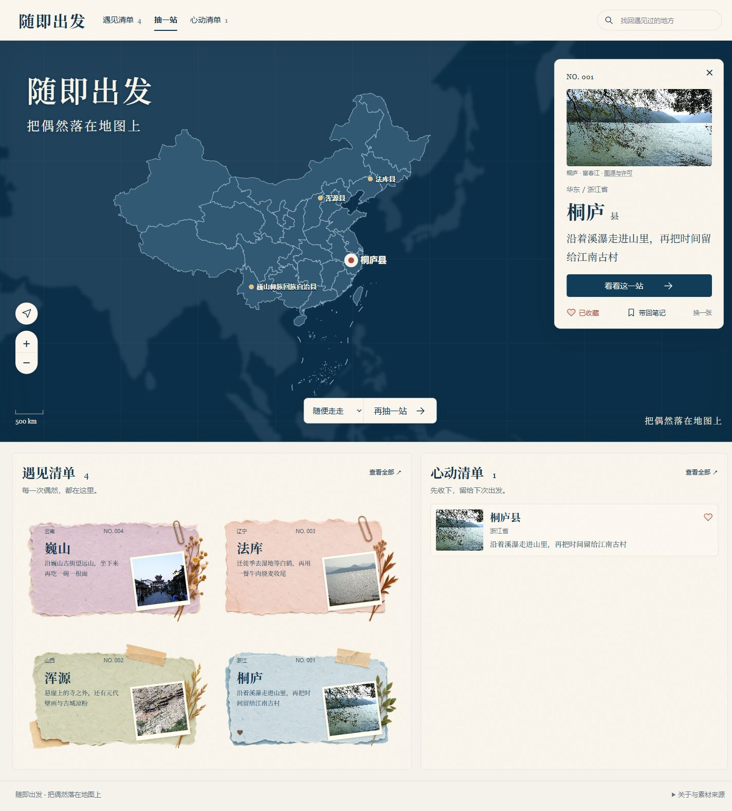
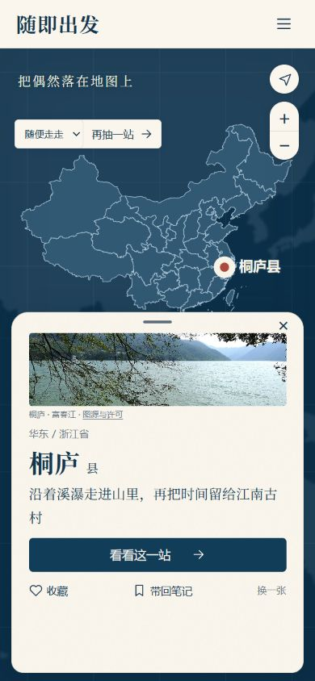
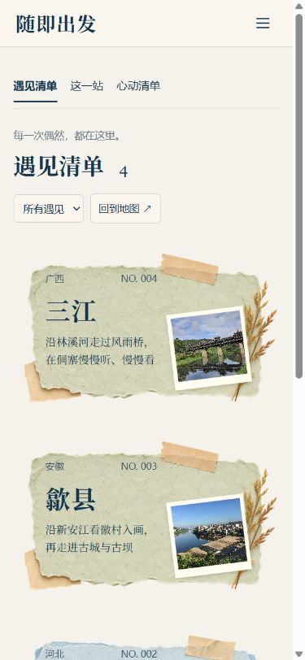
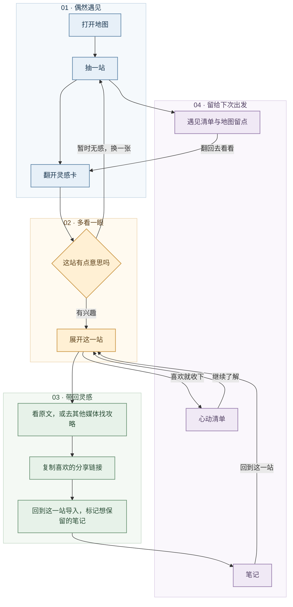

<h1 align="center">随即出发 <sub>RandomTravel</sub></h1>

<p align="center"><strong>把偶然落在地图上。</strong></p>

<p align="center">下一次出发，先抽张牌。</p>

<p align="center">
  
</p>

<p align="center">
  <a href="#预览">先看界面</a> · <a href="#核心功能">怎么玩</a> · <a href="#接下来怎么玩">接下来的版本</a>
</p>

## 一句话需求

难得放假，还没想好去哪儿？给想出门的人一局“赛博飞镖扎地图”：抽一个目的地，看看有没有让你愿意出发的理由。

## 项目介绍

### 地图这么大，先遇见一个地方

打开随即出发，把目的地交给一点运气。抽到熟悉的地方，可以找个新理由重逛；抽到没听过的县城，先看看它的灵感卡。

这一张可能是桐庐：沿着溪瀑走进山里，再把时间留给江南古村。下一张也许是高邮：读读汪曾祺与秦观，再去湖边等一场晚霞。

有兴趣，就展开看看，收进心动清单，再去找攻略。没感觉，换一张就好。每一次遇见都会留在地图和纸卡书架里，哪天想起来，还能翻回去。

### 一张灵感卡，要有让你多看一眼的理由

卡片先回答“为什么想去”，再补上“到了还能怎么玩”。

- 激活点：一个让人愿意出发的理由。可能是一段溪瀑山路、一位作家的故乡，也可能是想亲眼看看的湖边日落。
- 丰富点：把这趟出行填得更满一点。附近的古村、地方小吃，以及可以顺道逛的地方，都放在这里。

**试着连抽三站，看看你会留下哪一张。**

### 接下来怎么玩

#### v0.1 · 先玩起来（当前体验版）

28个国内目的地已经装进卡盒，覆盖七大区，既有县城，也有整座城市。先抽一站、翻翻资料，把喜欢的地方收下；电脑和手机都能玩。灵感卡采用预先编辑的内容，先让大家体验这件事有没有意思。

#### v0.2 · 找到真正让人想去的理由（规划）

同一个地方，有人看到古村就想去，有人要听到“可以走一条漂亮的山路”才会停下来。去附近过个周末，和专程跨省旅行，需要的理由也不一样。

这一版会通过深度用户访谈和实际试玩，弄清楚大家为什么收藏、为什么划走，哪些内容真的让人想继续查攻略。再用这些反馈调整灵感卡的内容和生成提示词（Prompt），把泛泛的景点介绍，改成更值得带给朋友看的出游提案。

#### v0.3 · 让收藏夹里的“下次一定”有下文（规划）

刷到过很多好地方，想出门时却记不清存在哪篇笔记里。这一版想把那些收藏重新用起来。

把你愿意带回的小红书、公众号、抖音等分享链接批量导入，让大语言模型（LLM）帮助整理其中的旅行线索。从你挑中的笔记和主动反馈里，逐渐了解什么更能打动你，再据此调整灵感卡的生成提示词。

你可以查看、修改或清空这些偏好。想随便探索的时候，也继续留一个“随便走走”的入口。

## 预览

### 网页 · 把地图打开，看看这次落在哪儿



### 手机 · 把一站旅行装进口袋

手机以地图为主，目的地卡片可以收起、半屏查看或展开阅读。

<p>
  
  
</p>

截图来自实际页面。你的遇见清单和心动清单，从自己抽到的第一站开始。

## 核心功能

| 你想做什么 | 可以这样玩 |
| --- | --- |
| 还没想好去哪儿 | 从28个目的地里抽一站，也可以先选个大方向；同一轮不会重复 |
| 先看看有没有兴趣 | 翻开灵感卡，先看出发理由，再看还能怎么玩 |
| 找回刚才那一站 | 在地图点选已经遇见的地方，或到纸卡书架里翻一翻 |
| 有点喜欢，先留下 | 放进心动清单，继续抽下一张，收藏会替你留着 |
| 趁好奇再多看一点 | 看资料原文，或带着具体检索词去小红书和公开搜索找攻略 |
| 带回喜欢的笔记 | 在这一站粘贴分享链接，一次可以带回多篇，再手动标记想保留的内容 |
| 给下次出发留个底 | 收藏、遇见和旅行备忘保存在本浏览器，也能导出另存 |
| 在手机上随手抽一站 | 收起卡片看地图，半屏看灵感，展开慢慢读资料 |

第一次带回链接后，笔记入口就会出现。v0.1先替你收好链接，后续版本再帮你读懂和整理。

## 业务流程



蓝色是偶遇，杏色是选择，绿色是继续探索，紫色是收进自己的清单。外站搜索由你打开，喜欢的链接由你带回。

## 技术介绍

### 技术栈

| 部分 | 实现 |
| --- | --- |
| 页面与交互 | HTML、CSS、原生 JavaScript |
| 地图 | SVG、GeoJSON、统一 Web Mercator 投影与等比缩放 |
| 内容 | 随站点打包的28张灵感卡、来源链接和图片信息 |
| 本地状态 | 浏览器 localStorage，支持旧记录迁移与 JSON 导出 |
| 图片 | 28张目的地实景配图、4款可复用纸卡底材 |
| 托管 | GitHub Pages，使用 GitHub Actions 发布静态文件 |

### 模块说明

| 文件 | 职责 |
| --- | --- |
| `site/index.html` | 页面入口、导航、旅行卡与清单容器 |
| `site/styles.css` | 蓝色地图与纸感界面、桌面和手机布局 |
| `site/app.js` | 抽卡、收藏、清单、资料展开、笔记导入与页面状态联动 |
| `site/core.js` | 不放回抽取、缓存迁移、链接去重与校验、卡片状态切换 |
| `site/map.js` | 坐标投影、地图缩放与拖动、历史点位、地名避让和比例尺 |
| `site/data.js` | 目的地内容、GeoJSON、照片信息及纸卡资源路径 |
| `site/media/` | 页面使用的实景照片与纸卡图片 |
| `.github/workflows/pages.yml` | 推送后将 `site/` 发布到 GitHub Pages |

### 仓库结构

第一版采用轻量静态站点结构：

```text
suiji-chufa/
├── README.md
├── .gitignore
├── .github/
│   └── workflows/
│       └── pages.yml
├── docs/
│   ├── PHOTO_CREDITS.md             # 逐图作者、来源和许可
│   ├── MAP_AND_ASSETS.md            # 地图与纸卡来源
│   ├── readme-badges.svg            # 介绍页状态条
│   └── previews/
│       ├── desktop.jpg
│       ├── mobile-half.jpg
│       └── mobile-encountered.jpg
└── site/
    ├── index.html
    ├── styles.css
    ├── app.js
    ├── core.js
    ├── map.js
    ├── data.js
    └── media/
```

### 本地运行

克隆或下载仓库后，在仓库根目录运行：

```bash
python -m http.server 8000 --directory site
```

浏览器访问 `http://localhost:8000/`。

### GitHub Pages 部署

发布包使用 GitHub Actions 上传 `site/` 静态文件并部署到 Pages。仓库启用 Pages 的 GitHub Actions 发布来源后，推送到默认分支即可更新站点；也可以手动触发工作流。

第一次部署完成后，将实际网址填写到本文的预览入口。此后把网址发给朋友，就能在电脑和手机远程体验。

部署配置依据 [GitHub Pages 官方工作流说明](https://docs.github.com/en/pages/getting-started-with-github-pages/using-custom-workflows-with-github-pages)。

### 对外接口与 API 配置

| 能力 | 当前实现 | 需要配置 |
| --- | --- | --- |
| 内容读取 | 加载仓库内静态数据 | 无 |
| 地图与配图 | 世界陆地与照片随站点打包；国内边界从 DataV 官方接口直接加载 | 无地图 Key、无图片 API |
| 小红书搜索 | 根据主题检索词生成跳转链接 | 无 API Key |
| 公开网页、公众号与抖音线索 | 跳转公开搜索引擎，后两者按网站范围检索 | 无 API Key |
| 笔记收纳 | 浏览器内解析分享链接并保存 | 无服务端接口 |
| AI 生成 | 当前使用预先编辑的卡片 | 无模型、无 LLM Key |

用户主动搜索或查看原文时会跳转外站。收藏、笔记链接和备忘保存在当前设备、当前浏览器中；使用导出功能可以另存一份。站点目前不提供跨设备同步。

### 地图与素材

世界陆地来自 [Natural Earth](https://www.naturalearthdata.com/)，国内边界数据来自 [DataV](https://datav.aliyun.com/portal/school/atlas/area_selector)。地图和点位采用同一套投影，不使用生成式地图或手工拉伸的中国轮廓。

实景照片逐图保留作者、原图和对应许可，见 [配图署名](docs/PHOTO_CREDITS.md)。纸卡底材依据本项目参考稿编辑重建，地图与素材说明见 [来源记录](docs/MAP_AND_ASSETS.md)。第三方图片与数据沿用各自的使用条件，与项目代码许可分开标注。

当前未附加开源许可证；第三方照片与数据的许可见各自来源说明。

喜欢哪一张、哪一站让你想立刻查攻略，欢迎到仓库 Issues 留下来。也许下一张灵感卡，就会因为这条反馈更有意思。
